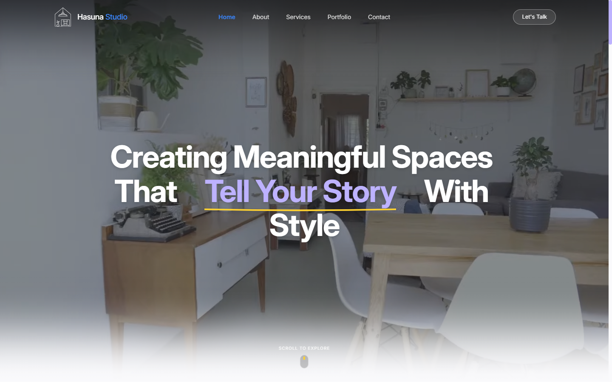
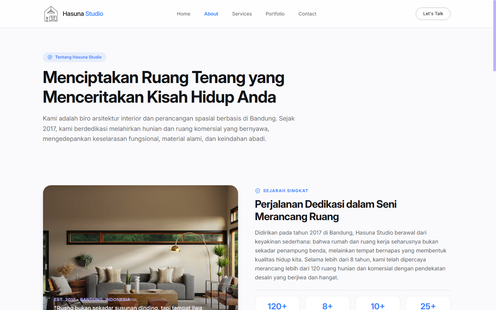
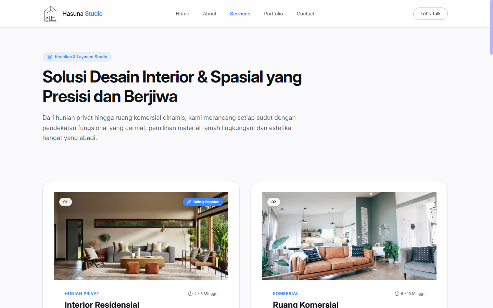
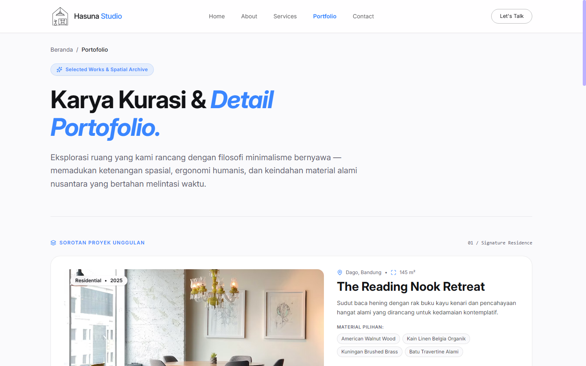
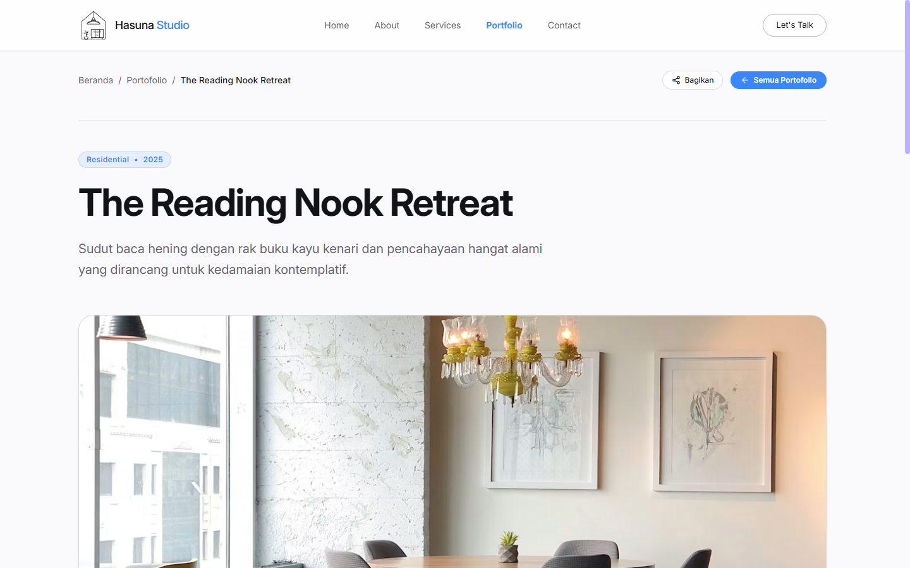
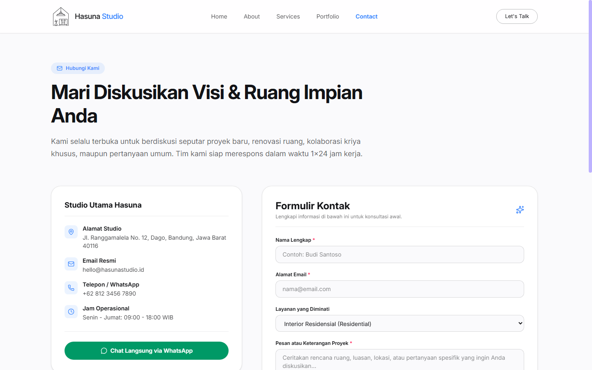

# Hasuna Studio — Interior Architecture & Spatial Design Web App

Tugas Pemrograman Internet (Promnet) — Pengembangan Website Profil Perusahaan Berbasis React, Tailwind CSS, dan React Router.

---

## Identitas Mahasiswa

| Keterangan | Data Mahasiswa |
| :--- | :--- |
| **Nama Lengkap** | **Muhamad zaldi hugraha** |
| **NIM** | **2505661** |
| **Kelas** | **Pilkom 3c** |
| **Mata Kuliah** | Pemrograman Internet |

---

## Deskripsi Singkat Website

**Hasuna Studio** adalah platform website profil biro arsitektur interior dan perancangan spasial kontemporer yang berlokasi di Bandung, Jawa Barat. Website ini dirancang dengan pendekatan estetika modern, tipografi bersih, dan interaktivitas yang halus. 

Website memadukan filosofi desain *mindful living*, material alami nusantara, dan ketenangan ruang hidup untuk menghadirkan pengalaman digital yang memukau bagi calon klien yang ingin merancang hunian privat maupun ruang komersial.

---

## Struktur Halaman & Fitur Utama

Website ini memenuhi seluruh ketentuan halaman minimal yang dipersyaratkan:

1. **Beranda (Home) — `/`**
   - **Hero Section**: Background video sinematik dengan tipografi berputar dinamis (*text rotators*) dan efek transisi halus.
   - **Ringkasan Perusahaan**: Bagian narasi filosofi spasial Hasuna Studio.
   - **Highlight Layanan & Portofolio**: Sorotan layanan unggulan dan kartu portofolio pilihan dengan tautan langsung ke halaman detail.
   - **Call-to-Action**: Tombol langsung untuk konsultasi dan eksplorasi karya.

2. **Tentang Kami (About) — `/about`**
   - **Sejarah Singkat**: Perjalanan pendirian studio sejak 2017 di Bandung dan pencapaian 120+ proyek.
   - **Visi & Misi**: Dipetakan secara terstruktur ke dalam kartu interaktif (*Card component*) beserta 3 pilar misi utama studio.
   - **Profil Tim Kreatif**: Menampilkan foto, nama arsitek/desainer, jabatan, dan bio singkat kepemimpinan studio.
   - **Statistik & Nilai Dasar**: Angka capaian studio (tahun pengalaman, kota dijangkau, penghargaan) dan prinsip kerja berkelanjutan.

3. **Layanan/Produk (Services) — `/services`**
   - **Daftar Layanan Lengkap**: Menampilkan layanan Interior Residensial, Ruang Komersial, Bespoke Furnitur, dan Konsultasi Spasial lengkap dengan deskripsi, cakupan pengerjaan, durasi, dan sasaran klien.
   - **Metodologi Proses Desain**: 4 tahapan sistematis (*Discovery, Schematic Design, Technical BoQ, Build Supervision*) beserta deliverables.
   - **FAQ Interaktif**: Jawaban seputar alur awal, wilayah luar kota, RAB, dan fabrikasi kriya kayu.

4. **Portofolio / Galeri (Portfolio) — `/portfolio` & `/portfolio/:id`**
   - **Galeri Proyek**: Katalog dokumentasi visual proyek interior yang telah diselesaikan.
   - **Filter & Pencarian**: Filter kategori interaktif (*All, Residential, Commercial, Living*) dan live search bar.
   - **Modal Quick View**: Pratinjau cepat gambar dan detail proyek tanpa meninggalkan halaman katalog.
   - **Halaman Detail Mendalam (`/portfolio/:id`)**: Menampilkan konsep desain, tantangan tapak, solusi arsitektural, material spesifikasi, dan palet warna heksadesimal.

5. **Kontak (Contact) — `/contact`**
   - **Formulir Kontak Berakurasi**: Input nama lengkap, alamat email, pilihan layanan, dan pesan proyek dengan validasi sederhana (cek format email, panjang minimal, serta notifikasi error & feedback sukses).
   - **Informasi Studio Fisik**: Alamat studio di Dago, Bandung, nomor telepon, email resmi, dan jam kerja operasional.
   - **Direct WhatsApp Chat**: Tombol pintas untuk langsung memulai percakapan via WhatsApp.
   - **Info Media Sosial**: Tautan langsung ke Instagram, Pinterest, dan LinkedIn Hasuna Studio.

---

## Ketentuan Teknis yang Diterapkan

- **Framework & Tooling**: Dibuat menggunakan **React 19** dengan bundler modern **Vite**.
- **Styling**: Menggunakan **Tailwind CSS v4** murni tanpa framework CSS eksternal lain seperti Bootstrap.
- **Navigasi Antarhalaman**: Memanfaatkan **React Router DOM (v7)** dengan komponen `<Routes>`, `<Route>`, `<Link>`, dan navigasi terintegrasi.
- **Komponen Reusable**: 
  - Komponen `Navbar` (fixed header dengan transisi blur dan menu mobile responsif).
  - Komponen `Footer` (informasi studio, sosial media, hak cipta, dan navigasi cepat).
  - Komponen `Card` (kontainer kartu serbaguna yang digunakan ulang di seluruh halaman: Visi-Misi, Profil Tim, Layanan, Kontak, dan Portofolio).
- **Data-Driven Architecture**: Seluruh data konten (layanan, profil tim, portofolio, visi-misi, media sosial, dan FAQ) disimpan dalam struktur array objek di [`src/data/companyData.ts`](src/data/companyData.ts) dan di-render menggunakan fungsi `.map()`.
- **Desain Responsif**: Menggunakan breakpoint standar Tailwind (`sm`, `md`, `lg`, `xl`) sehingga tampilan rapi di perangkat mobile, tablet, hingga desktop layar lebar.
- **Git & `.gitignore`**: Folder `node_modules/` dan `dist/` dikecualikan secara ketat melalui file [`.gitignore`](.gitignore).

---

## Cara Menjalankan Project Secara Lokal

Ikuti langkah-langkah berikut untuk menjalankan website di komputer Anda:

### 1. Prasyarat
Pastikan Anda sudah menginstal **Node.js** (versi 18 ke atas disarankan) dan **npm** di komputer Anda.

### 2. Clone Repository
```bash
git clone https://github.com/Zaldi07/sehatin-app.git
cd sehatin-app
```

### 3. Instal Dependensi
Jalankan perintah ini untuk mengunduh seluruh dependensi proyek:
```bash
npm install
```

### 4. Jalankan Server Pengembangan (Development Server)
```bash
npm run dev
```
Setelah server aktif, buka peramban web dan akses alamat lokal yang ditampilkan di terminal (biasanya `http://localhost:5173/`).

### 5. Menjalankan Build Produksi (Opsional)
Untuk menguji hasil bundle produksi:
```bash
npm run build
npm run preview
```

---

## Dokumentasi & Screenshot Setiap Halaman

Berikut adalah tangkapan layar (screenshot) asli dari setiap halaman website Hasuna Studio:

### 1. Halaman Beranda (Home — `/`)
> Menampilkan Hero Section dinamis, animasi headline teks, dan navigasi utama studio.



---

### 2. Halaman Tentang Kami (About — `/about`)
> Menampilkan Sejarah Singkat studio, Visi & Misi perusahaan, nilai-nilai dasar, serta Profil Tim Arsitek Spasial menggunakan komponen Card reusable.



---

### 3. Halaman Layanan (Services — `/services`)
> Menampilkan daftar keahlian dan lingkup layanan, metodologi proses desain 4 tahap, serta FAQ interaktif.



---

### 4. Halaman Portofolio (Portfolio — `/portfolio`)
> Menampilkan kurasi proyek, filter kategori, kotak pencarian, dan kartu sorotan proyek unggulan.



---

### 5. Halaman Detail Portofolio (`/portfolio/:id`)
> Menampilkan studi kasus arsitektural lengkap dengan spesifikasi tapak, galeri foto, material, dan palet warna.



---

### 6. Halaman Kontak (Contact — `/contact`)
> Menampilkan formulir kontak dengan validasi input interaktif, alamat studio fisik, jam kerja, tombol WhatsApp, dan info media sosial.



---

&copy; 2026 **Muhamad zaldi hugraha** (NIM: 2505661) — Pilkom 3c. All rights reserved.
